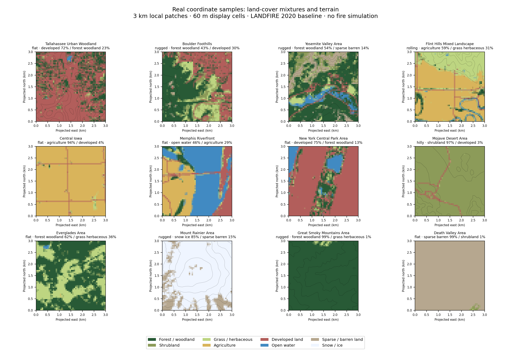

# Fire-eye · CONUS Landscape Context

Coordinate-specific terrain and land-cover distributions for customized wildfire
simulation scenes across the contiguous United States. Provide a longitude and
latitude; receive surface fractions, terrain statistics, source coverage and
scene-selection tags.

**[Download the complete handoff · v1.1.1](https://github.com/LabRAI/fire-eye-landscape-context/releases/download/v1.1.1/FireEye-Landscape-Context-v1.1.1.zip)**

Includes the original national atlas under package/, the new geographic-object samples, scripts, research notes and shared-map demo.

[Integration guide](package/README.md) · [Response format](package/response.schema.json) · [Example responses](package/examples) · [Release and checksums](https://github.com/LabRAI/fire-eye-landscape-context/releases/tag/v1.1.1)

No GitHub sign-in, API key or laboratory server access is required. The complete
release ZIP includes the national data. GitHub's green **Code → Download ZIP**
contains the repository's documentation, scripts and examples only; use the
complete-package link above for coordinate lookup.

## Building and street detail

A [digital-scene demo](https://labrai.github.io/fire-eye-landscape-context/demo/)
keeps one geographic map and camera from national scale to local buildings,
streets and schematic trees at recorded locations. See the
[digital modeling direction](docs/DIGITAL_SCENE_DIRECTION.md).
See the [API and data-source review](docs/DATA_SOURCES.md), [implementation plan](docs/MICROSCENE_PLAN.md) and
[geographic object contract](scene/OBJECT_CONTRACT.md) for the simulation provider.
This finer scene layer is separate from the unchanged national v1.0.1 atlas.
The online demo's **Simulation** action now opens the existing Fire-eye renderer
for that location; see [simulation integration](docs/SIMULATION_INTEGRATION.md).
The downloadable v1.1.1 archive remains the frozen geographic-data handoff;
the new online bridge is available in the current repository.

## What is included

- **901,703 national 3 km cells:** coordinate bounds and eight surface categories: forest/woodland, shrubland, grass/herbaceous, agriculture, developed land, open water, sparse/barren land, and snow/ice.
- **Terrain:** elevation, relief, slope and broad terrain descriptors.
- **Offline lookup:** a compact numeric atlas, CSV export and Python coordinate-query script.
- **12 real-location examples:** national distributions and finer local layouts, plus three additional coastal checks.
- **Source records:** LANDFIRE product metadata, response schema, validation results and integrity checksums.

## Get a distribution

Download and extract the complete handoff, then open a terminal in its package/ folder.
Use Python 3.11 or later:

~~~sh
python -m pip install -r requirements.txt
python query.py --bundle . --longitude -84.28 --latitude 30.45 --output scene.json
~~~

Coordinates are WGS84: **longitude first, latitude second**. Reuse one loaded
Atlas instance when serving many requests. The simulation author uses the
returned distributions for scene selection, object placement and animation.
See the [integration guide](package/README.md) for layout coordinates and examples.

## Resolution and scope

The national lookup describes a **fixed 3 km cell**, derived from LANDFIRE 2020
source editions with 30 m native pixels. It represents baseline geography.
It is not live vegetation, weather, a fire forecast or a fire-spread simulation.
Surface fractions sum to one over mapped land cover; missing coverage remains
explicit, and overlapping tags must not be added to surface fractions.

The 12 local examples include finer spatial grids. Generating a new native local
patch requires the original vegetation/elevation/slope rasters and rasterio;
those large rasters are not included. The national lookup works entirely offline
with the release ZIP.

## Provenance and integrity

Public delivery **v1.0.1**, 31 October 2026, packages the v1 data prepared on
26 October 2026. Numeric arrays, CSV, example responses, schema and original
source metadata are unchanged. Portable paths and public delivery instructions
replace server-specific references.

Original product metadata and notices are preserved under
[package/source_metadata](package/source_metadata); source limitations are in
[package/source_notes.json](package/source_notes.json). Public availability does
not replace the source providers' terms or notices.

Verify the download with the release's SHA256SUMS file. The complete handoff contains bundle-checksums.json; package/checksums.json retains the national atlas integrity record.

The [original national-only v1.0.1 release](https://github.com/LabRAI/fire-eye-landscape-context/releases/tag/v1.0.1) remains available unchanged.
