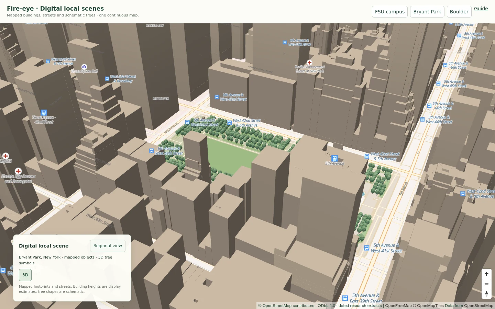

# Geographic scene pilot · delivery status

2 November 2026

## Available in this delivery

- A single MapLibre map and camera from national overview to building-scale view.
- Gradual street/building detail, 2D/3D viewing, return to regional view, and
  schematic 3D tree symbols at recorded locations. No aerial-photo scene layer.
- Original OSM vector building footprints and street geometry through the public
  OpenFreeMap basemap. Rendered heights remain explicitly described as estimates
  unless independently verified; they are not survey measurements by this project.
- Two downloadable, dated OSM object extracts, with complete available geometry,
  IDs, source dates, attribution, nullable attributes and file checksums.
- A reusable extractor and geographic object contract for the simulation author.

The Fire-eye HF/GitHub preview's Simulation entry opens the existing representative
scene; Map location switches to the geographic camera view. The online demo also
provides a Simulation action through the same renderer. See
[simulation integration](SIMULATION_INTEGRATION.md) for scope and data flow. The production domain is not changed by this
pilot. A new terrain-following fire-spread solver or fully georeferenced animation
engine is not included.

## Actual sample contents

| Extract | Buildings / parts | Transportation | Tree points | Additional mapped features |
| --- | ---: | ---: | ---: | --- |
| FSU campus | 29 | 271 | 0 recorded in this extract | 3 land areas, 1 water feature, 6 address points |
| Bryant Park area, New York | 326 | 166 | 565 | 80 land areas, 44 pedestrian areas, 16 water features, 110 address points |

Counts describe records, not necessarily distinct physical buildings or complete
inventories. Source ways can extend beyond the requested bbox to retain complete
object geometry. The New York converter omitted one incomplete feature. No
procedural objects were added to fill missing geometry. Zero recorded trees in
the FSU sample does not mean the campus has no trees.

Map footprints, tree point positions and scene heights have different evidence
levels. This screenshot is a real rendering of source data, not an AI-generated
image; displayed building shapes/heights are not a guarantee of current survey
accuracy. Tree locations follow source records; their displayed shapes and dimensions are
schematic. See [design direction and next steps](DIGITAL_SCENE_DIRECTION.md).

## Verified behavior

- Desktop 1440 px and mobile 390 px: one map canvas, correct geographic anchor,
  continuous zoom to local view, return navigation and no horizontal overflow.
- Integration keeps the same selected forecast issue and sidebar state.
- Clicking the independently selected source-polygon interior identifies
  Robert Manning Strozier Library (OSM way/106455325).
- The New York scene displays 565 recorded tree points as schematic 3D symbols;
  selections return their original Point geometry and nullable heights.
- Sample geometry passed validity checks; download bytes are hash-checked before
  the viewer adds an object collection.
- Detailed-object failures preserve the geographic map.
- The 1 November active-fires regression passed for standard and 50 m maps on desktop and
  mobile: reports remain over the same heatmap/date, and the tested source
  failure can be retried. No laboratory-server requests were made by these tests.
- The extractor dependency audit reported zero known vulnerabilities at the check.

These checks validate implementation and source-record consistency. They are not
a nationwide ground-truth survey, a hardware-independent performance guarantee,
or validation of building-level wildfire prediction.

## Next integration priorities

1. Batch-ingest and deduplicate Overture/authoritative local footprints and
   address records, preserving source quality and update dates; publish our own
   versioned tiles through HF.
2. Add real 3DEP terrain and appropriate municipal tree/canopy sources. Define
   local-metre coordinates and vertical datum before placing 3D assets.
3. Have the simulation renderer consume full object geometries and known
   attributes rather than regional fractions or random asset positions. Keep
   physics/forecast validation separate from visual detail.

The national v1.0.1 distribution atlas remains byte-for-byte unchanged inside the
new complete handoff. The new geographic-scene material is an additional layer.
